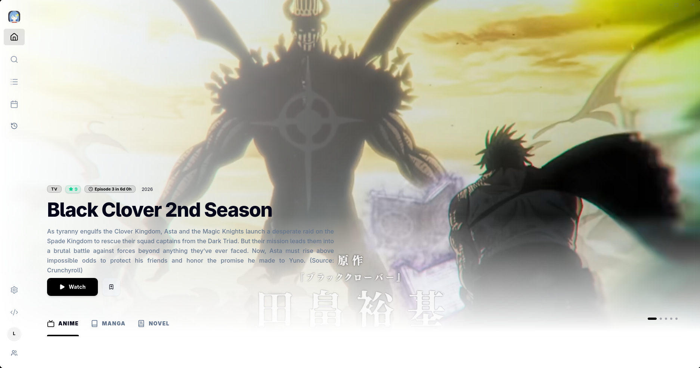
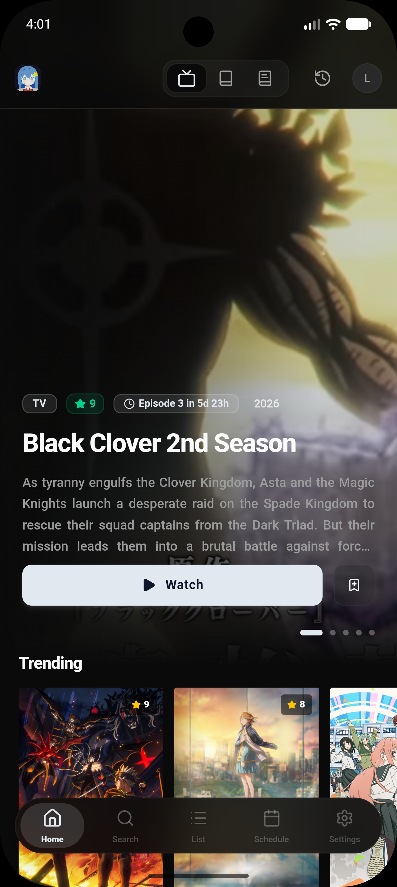

<p align="center">
  
</p>

<h1 align="center">Hoshi ⭐</h1>

<p align="center">
  A clean, lightweight tracker for anime, manga, and light novels — across desktop, mobile, and Android TV. <br>
  Built to be <strong>potato-proof</strong>.
</p>

<p align="center">
  
  <a href="https://github.com/hoshi-io/hoshi/releases">
    
  </a>
  <a href="https://github.com/hoshi-io/hoshi/releases">
    
  </a>
  <a href="https://github.com/hoshi-io/hoshi/blob/master/LICENSE">
    
  </a>
</p>


---
## Features

-  **Smart Tracking:** Sync your library with AniList, MAL, Simkl, Kitsu, MangaBaka, Shikimori or MangaUpdates. You can keep everything local if you prefer.
-  **Conflict-aware Sync:** Choose how conflicts between trackers are resolved, see what changed in the list editor, and check each entry's history. Changes made offline sync automatically once you're back online.
-  **Powerful List Management:** Keep your library organized with advanced tools, including list merging and batch actions for managing multiple entries at once. Duplicate entries can be detected and merged into a single item.
-  **Customizable Home:** Build your own home with tabs and sections from AniList, MangaBaka or your installed extensions.
-  **BYOC Extensions:** Bring your own content by adding marketplace URLs. Browse and install extensions directly from the app.
-  **Compatibility Layers (experimental):** Run LNReader extensions and Stremio addons natively inside Hoshi, no extra installation required. Stremio addons work for anime, and debrid links play directly.
-  **Advanced Player:** A libmpv based player with Anime4K integrations, auto skip for intros and outros, autoplay, resume playback and seek bar thumbnails.
-  **Advanced Readers:** Custom, highly configurable readers for manga and light novels, with the next chapter preloaded in the background.
-  **Subtitle Customization:** Fully customizable subtitles, powered by libmpv and libass.
-  **Built-in Torrent Client:** Stream torrents directly in Hoshi with librqbit, with zero configuration required. It picks the best release based on your preferred groups, resolution, codec and audio, and remembers which torrent belongs to each entry.
-  **Release Schedule:** Stay up to date with a built-in calendar that shows upcoming anime releases and airing episodes at a glance.
-  **Profiles:** Create multiple profiles, each with its own avatar, library and optional password.
-  **Discord Rich Presence (desktop only):** Show what you're watching or reading on your Discord profile, with options to hide titles and NSFW content.
-  **Customization:** Personalize the experience with themes and adjustable accent colors to match your style.
-  **20 Languages:** Fully localized interface in 20 languages (AI translations).

## Preview

<p align="center">
  
  &nbsp;&nbsp;
  
</p>

## Under the Hood

Hoshi is built with a modern, performance-focused stack:

- **Frontend:** SvelteKit (static) with Tailwind CSS and shadcn-svelte for a fast, responsive UI.
- **Backend/Core:** Rust + Tauri for a lightweight, native experience.
- **Player:** libmpv with libass for subtitles.
- **Torrents:** librqbit for streaming torrents.
- **Database:** SQLite via sqlx for simple and reliable local storage.
- **Extensions Sandbox:** QuickJS, providing a secure and isolated runtime for extensions.

## Downloads

Check out the [Releases](https://github.com/hoshi-io/hoshi/releases) page to download the latest version for your platform.

### Android
<a href="https://play.google.com/store/apps/details?id=com.ninelfx.hoshi">
  
</a>

Android TV is supported with its own TV interface.

### iOS

The `.ipa` on the [Releases](https://github.com/hoshi-io/hoshi/releases) page is unsigned and meant for sideloading with tools like AltStore, SideStore or Sideloadly, which sign it with your own Apple ID.

To get updates inside AltStore or SideStore, add this source:

```
https://github.com/hoshi-io/hoshi/releases/latest/download/altstore.json
```

> iOS support is experimental: it has only been tested on the iOS simulator so far. Bug reports from real devices are very welcome.

### macOS

> macOS support is experimental: it has only been tested in a virtual machine so far. Bug reports from real Macs are very welcome.

### Linux

In order to use the app player you need libmpv installed in your system.

#### Arch-based distributions

```bash
yay -S hoshi-bin
```

---
> **Credits:** Data via [AniList](https://anilist.co/), [MAL](https://myanimelist.net/), [Kitsu](https://kitsu.app/), [Simkl](https://simkl.com/), [Shikimori](https://shikimori.one/), [MangaUpdates](https://www.mangaupdates.com/) • Skip times by [AniSkip](https://aniskip.com/) • Mappings by [MangaBaka](https://mangabaka.org/) & [animeApi](https://github.com/nattadasu/animeApi)

## ⚖️ Disclaimer

Hoshi is primarily a tracking and management tool. The built-in readers and players are designed to work with user-provided content (Bring Your Own Content). The developers of Hoshi do not host, provide, or link to any copyrighted media. Users are solely responsible for the content they consume and the extensions they install.

---

<p align="center">
  
</p>
<p align="center">
  If you like Hoshi, consider giving it a ⭐. After all, hoshi means star.
</p>